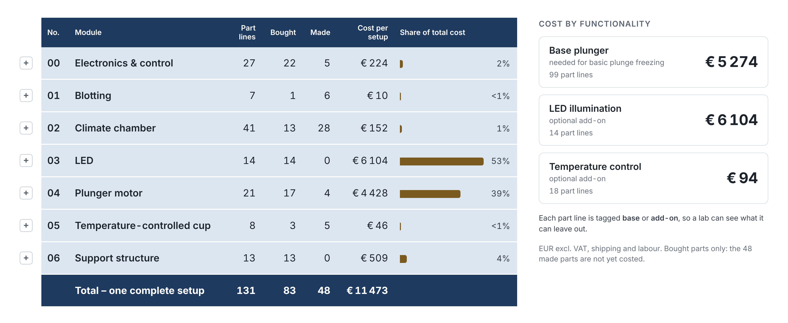
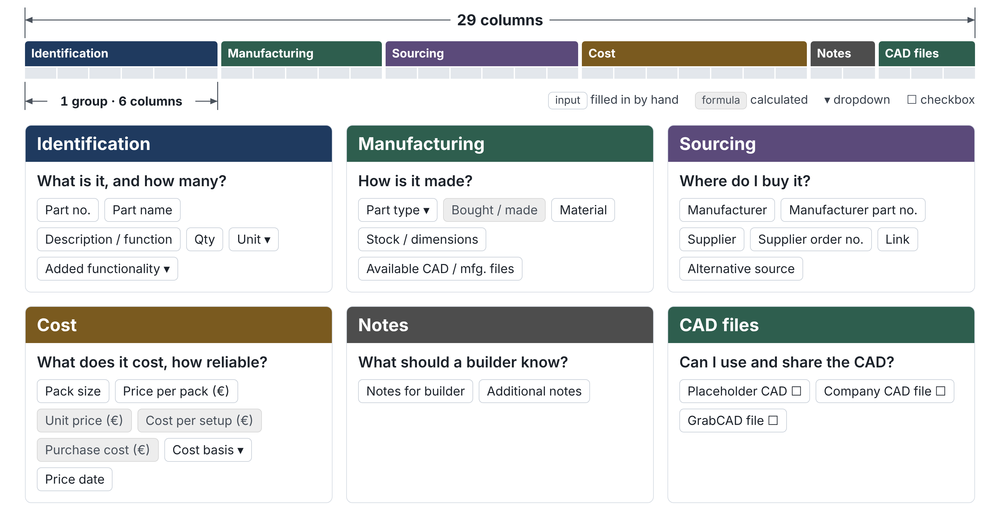
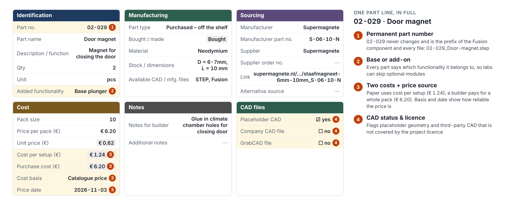

# Bill-Of-Materials
As already mentioned in the general overview [ReadMe](../README.md), the Bill of Materials is the leading document inside this repository. Within the BOM, all the information can be found for all the specific parts. Here, it will be explained what all can be found inside the BOM and how the BOM is structured and should be read.

The BOM has the following 4 tabs:
- BOM
- Summary
- ReadMe
- Lists

## BOM tab
The first tab is the actual BOM itself. Inside the BOM, all 7 modules are created as drop-down rows. All the parts are placed inside the module where they are used. For every part, it is defined whether it is a bought part or a made part. Additionally, an attempt is made to supply a cost for every part. This in total results that a total cost per module can be estimated as well as a cost for the total setup. An overview of the first level of the BOM showing all the Modules dropdown menus is shown below:

_image is made based on the BOM content at 18-11-2026_

For the majority of the bought parts, a price indication was found. For several custom-made parts, it was not. This results in the total price for the setup shown inside the BOM being likely slightly lower than what it would actually cost to build the setup in full. The setup was also built near the end of 2020. For several parts in the BOM, the prices are based on quotes still available from ordering the parts in 2020. Inside the BOM, it is shown for which parts this is the case. Due to inflation, it is therefore very likely that the prices for these parts in the BOM are severely outdated.

As already mentioned in the general ReadMe, all the parts in the setup are divided into 3 functionalities. All the parts that are required for setting up the base plunger, including humidity control inside the climate chamber, are categorized under the base plunger functionality. All the parts that are required to add the temperature-controlled cup functionality to the setup are marked as such. A similar thing is done for all the parts required for the LED sample activation functionality. By categorizing the parts under their added functionality, an overview is created of the added costs required to add one of the functionalities to the base plunger setup. Since not everyone might be interested in all the functionalities, one can now easily see what the costs per functionality are so that one can choose whether or not they want to add certain functionalities to the base plunger setup.

**Part information content**

When expanding the drop-down menus of the modules, all the parts belonging to that specific module appear. To give an overview of all the information available per part, an overview picture is created and shown below:

Every part is assigned a part number in the following format: MM-NN. Where MM stands for the module number and NN for the part number within that respective module. These part numbers are used throughout the repository to refer to parts and the naming of CAD files. For every part, there are 29 columns of content divided into 6 groups. Each part is classified either as a bought part or as a made part. Depending on the type of part, varying content is supplied for that part. The columns also come in varying shapes, such as drop-down boxes, automatically calculated cells, checkboxes, or just simple written input cells. In the content per part picture shown above it is already indicated which column is what kind. 

For every part, a short description is added about its function or where it is used. Then, as already mentioned before, every part is attributed with an added functionality that refers to whether it is required for the base plunger functionality or any of the other 2 functionalities. When a part is bought, the possible suppliers and the link to the part at the supplier, along with the costs, are provided. In the case of custom-made parts it is written down how it is produced and of what material. Inside the BOM, it is also written down which CAD and manufacturing files are supplied for each part. The possible file options used in this repository are:
- STEP
- Fusion
- STL
- DXF
- PDF (In case of production drawings)

Finally, there is a set of checkboxes that mark what kind of CAD file it is. As mentioned in the general overview [ReadMe](../README.md), not every part is designed by us. In some cases, STEP files are downloaded from either GrabCad or from the manufacturer's website. When this is the case, the parts are marked as such inside the BOM. In the case of some other Bought parts, there was generally no CAD model available. In those cases, a rough placeholder part is created in Fusion that is then placed inside the assemblies. This results in the location of these parts still being shown in the assembly pictures. These placeholder parts are, however, not made to accurately capture the parts as they are in real life. With that is meant, that one should not use the dimensions of the parts marked as Placeholder CAD since they likely will not be the same as the actual part.

**Example BOM for single part**

With the general structure of the BOM shown and explained, an example of all the information supplied for a single part can be seen in the picture below:

In the example, a door magnet is shown that is used inside the climate chamber module with module number 02. The door magnet is a purchased part, and 2 pieces are used. In the sourcing section, a possible supplier is provided where this type of magnet can be ordered. In the cost section, the price of these magnets at the source shown is then provided. Finally, there are some additional notes supplied for assembly. In this case, no CAD file was available, so a rough placeholder file was created and used in the assembly. This placeholder file does not match the dimensions of the actual part. 

** Summary tab

In the summary tab, an overview is provided of the total number of parts used per module, along with the total costs. Below is a picture showing how that actual summary looks inside the BOM.

_Image taken of the BOM summary tab on 18-11-2026_

In addition to the module overview, in the summary tab also a summary is created that summarizes the costs and parts used per added functionality. Below is a picture showing how that cost summary per added functionality looks inside the BOM.

_Image taken of the BOM summary tab on 18-11-2026_
