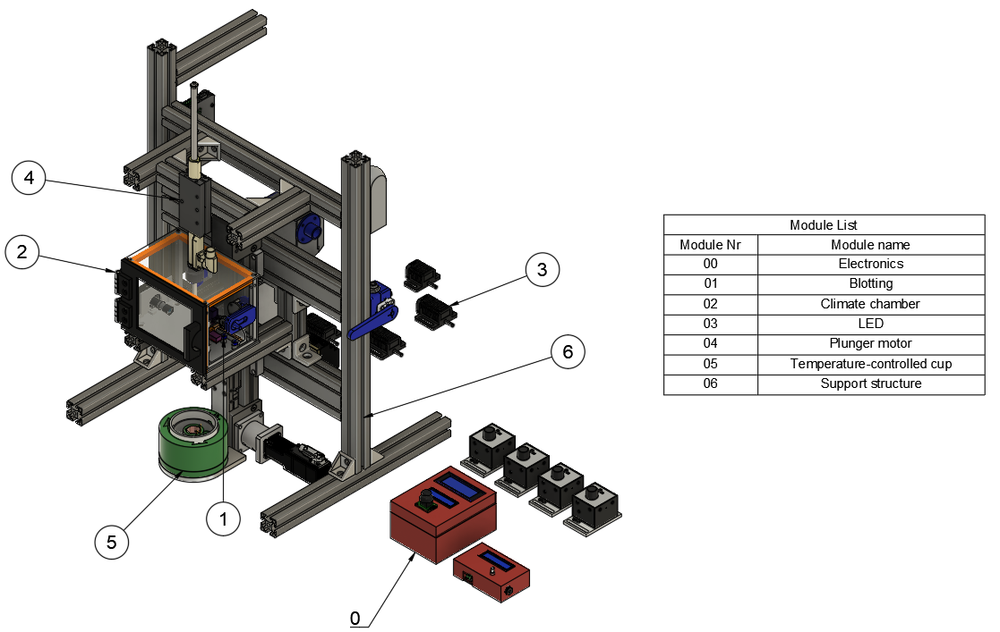
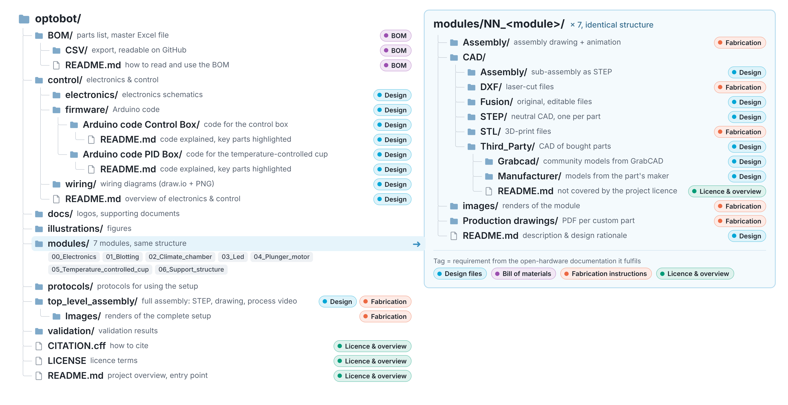

# optobot

Optobot is a plunger setup designed for sample preparation in Cryo-EM. The goal of the project was to create a plunger setup that is faster, more consistent, and more accurate than other custom-made plunger setups. Simultaneously, the goal is to be significantly cheaper than any full vitrification setups that are currently available on the market. As a result, Optobot is designed as a middle-class plunger setup with the idea that the Optobot plunger vitrifies samples very consistently, while having a cost price that allows placement of the plunger setup within multiple labs. Placing several plunging setups across multiple labs would increase accessibility. Additionally, the Optobot plunger is designed in such a way that it is highly modifiable, allowing modification of the setup towards varying research requirements. 

The Plunging setup shown within this repository was originally created at the end of 2020. Afterwards, it was continuously improved upon. The entire setup is now published as an Open-Hardware publication in the journal ... The full publication can be found here:

_add Open hardware publication link_

This repository initially served as the backing content for the Open-Hardware publication. The repository is now meant for continuous iteration, improvement, and expansion of the setup by the community.

## Optobot structure overview
The full Optobot assembly is recreated in Fusion 360. Of the full assembly, a render is made, which can be seen below:

To clearly show how the setup works, a small animation is created of the process of the Plunger setup through animation in Fusion 360. The full animation can be found [here](top_level_assembly/Optobot_process.mp4).

### Optobot module overview
Optobot is divided into 7 different modules. This division, along with the assigned module numbering, is used throughout the repository. These modules are the following:
- 00 Electronics
- 01 Blotting
- 02 Climate chamber
- 03 LED
- 04 Plunger motor
- 05 Temperature-controlled cup
- 06 Support structure

To give an overview, the separate modules are marked with balloons in the picture below:

### Functionalities
The total assembly as presented can be divided into 3 functionalities. First of all, the setup is designed to act as a standard plunger for vitrification with a climate chamber that allows humidity control. This together is considered the base plunging functionality. There is a control box created for the plunging setups, which allows control of the plunging and humidity parameters. On top of that, temperature control of the ethane cup is added as a functionality. This temperature control is achieved by adding a thermal heater to the bottom side of the brass cup and a thermocouple that is dipped into the ethane, which constantly measures the temperature of the ethane. A separate PID control box is added that can actively monitor and control the temperature of the ethane. This temperature control functionality is explained in more detail [here](modules/05_Temperature_controlled_cup/README.md). The third functionality that this plunging setup provides is sample activation through LED light. Within this setup, green and UV LED light sources are connected through lenses that can activate the biological cells on the grid, right before plunging. These LED sources are again controlled by the control box of the plunging setup itself. For more information specifically about the LED sample activation functionality, you are redirected to [here](modules/03_Led/README.md)

## Optobot folder structure & contents
Here, an overview will be provided of the Optobot repository, showing what content is supplied, along with where the content can be found. Since this repository is also created for Open-Hardware, all the elements have the original, modifiable files supplied for them, along with generic file variants meant for sharing. This means that for certain elements in the repository, multiple file types are available. In the picture below, the full overview of the repository is shown: 

**BOM**

The [Bill-Of-Materials](BOM/README.md) (BOM) has its own folder and should be treated as the leading document within this repository. Within the BOM, everything related to all the parts used within the Optobot setup can be found. Every part has its own respective part number, which is used throughout the entire repository. These part numbers all follow the same MM-NN format, where MM stands for the module number the part is used in, and NN stands for the specific part number within the module. Within every document, parts are structurally referred to by a combination of their part number and part name. The BOM then provides all the information for every part.

**Top level assembly**

In the [top_level_assembly](top_level_assembly) folder everything related to the overall assembly can be found, such as the full Cad Assembly, full assembly drawings. Additional renders of the full assembly, along with the process step animation of the full setup, can be found within this folder. 

**Modules**

For each of the modules, a separate folder is created with an identical structure. Each module also has its own ReadMe in which that specific module is visualized, along with pictures showing exploded views of the modules in which the parts used within the module are indicated. For each module, the function it serves in the assembly is explained, along with how the module specifically works. Then, for every module, a small Assembly animation is created that starts from the exploded view already shown. In the Assembly folder of every module, the assembly drawings along with the mentioned assembly animations can be found. Within the CAD folder, everything related to CAD can be found for that specific module. The total CAD assemblies are provided in the CAD/Assembly folders. For all the parts, the STEP files are provided, and in cases where the part is a custom-made part, then also the Fusion file is provided that allows modification of the part. In the case of 3d printed parts or laser-cut parts, the respective STL and DXF files are provided, as required for production. Within the BOM, for every part, it is shown which file types are supplied in the repository. In some cases, STEP files from third parties are downloaded and used in the total assembly. These STEP files are in no way part of the license of this repository. In doing so, we do not claim any sort of ownership over these parts since ownership still lies with the original authors. The STEP files that were all downloaded from third parties are placed in the CAD/Third_Party folder. They are placed in the repository as design references. Inside the Third Party folder, an additional ReadMe is placed that repeats that the files are not part of the License.

For any parts that are custom-made using a different production method than laser cutting or 3D printing, production drawings are supplied in the production drawings folder. Lastly, every module folder also has an image folder in which additional renders and pictures of the module can be found. 

**Control**

Within the control folder, everything related to the electronics and control can be found. In the control folder [ReadMe](control/README.md), the menus that can be found on the Control box and PID box are visualized and explained. Further in the folder, the Wiring diagrams can be found along with the Arduino code. For the entire setup, there are 2 Arduino codes. The first Arduino code is for the Control Box, which controls the entire plunger setup, including the humidity. In the supporting [ReadMe](control/firmware/Arduino code Control Box/README.md), the code is explained in detail. All the modifiable parameters are highlighted, which clarifies which parts of the code can be altered to align with each created setup. A similar explanation is provided in the [ReadMe](control/firmware/Arduino code PID Box/README.md) supporting the PID box Arduino code. Where the PID box is the active controller of the temperature-controlled cup.
