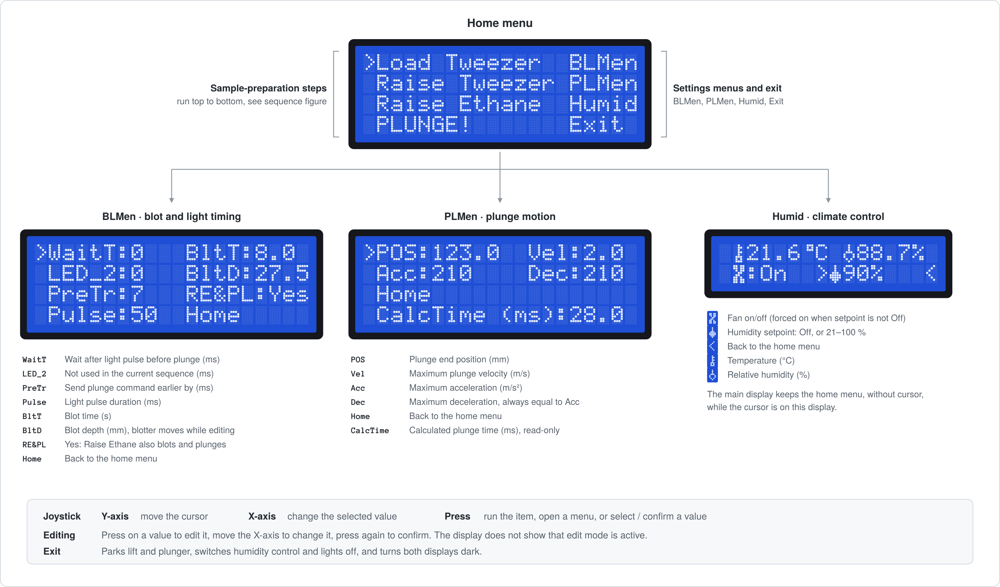
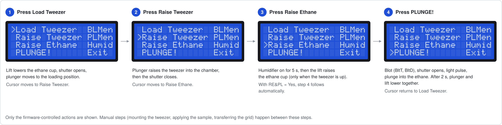
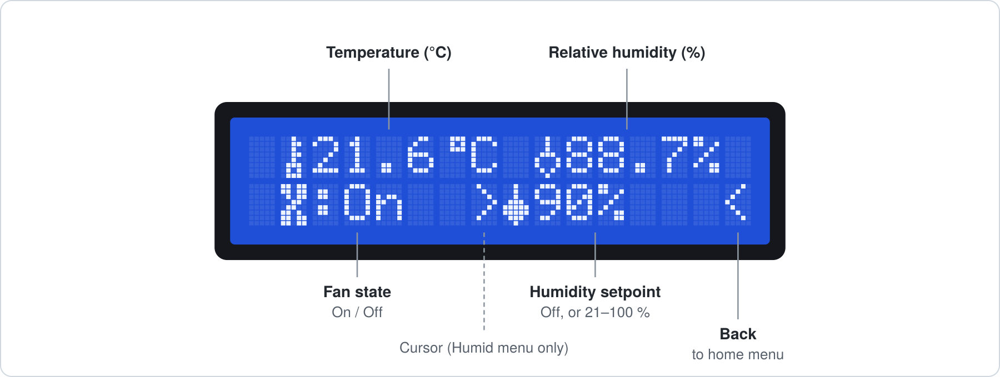
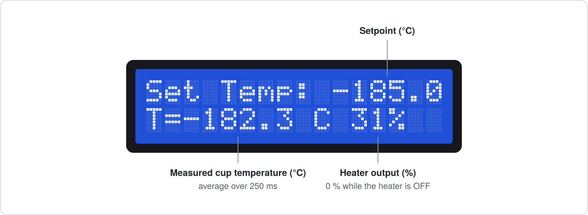
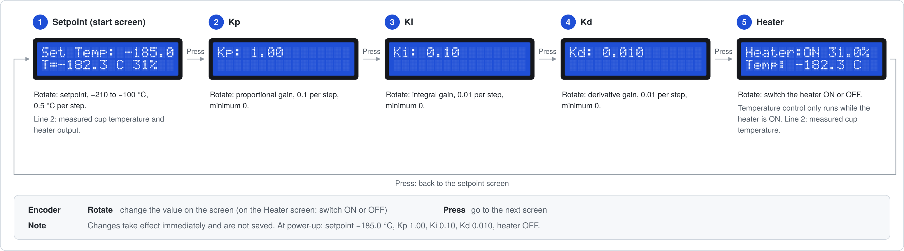

# Control
Under Control fall all the electronics, the Arduino code, and the wiring. Here will an overview be presented of these contents. In the case of the Electronics, the specific types of electronics used are all provided in the [BOM](../BOM). The CAD assembly of the control box and PID box, along with GrabCAD placeholders for the electronic components, is all placed inside the [electronics module](../modules/00_Electronics/README.md). Within that folder is also shown how the control box and PID box are assembled.

**Control box**

For clarity, when referring to the control box, we are referring to the 3d printed box, all its electronic components, and its driving software. The control box is used to control and drive the entire plunging setup. Here, the wiring diagram of the control box will be shown and explained. In addition to that, the created operating menu of the control box will be shown and explained. The Arduino code of the control box itself will be explained in detail [here](../control/firmware/Arduino code Control Box/README.md). 

**PID box**

For the PID box, we are referring to the 3d printed box and its contents, which drive and control the temperature-controlled cup assembly. Similar to the control box, the wiring diagram and operating menu of the PID box will be explained here. The Arduino code of the control box itself will be explained in detail [here](../control/firmware/Arduino code PID Box/README.md). 

## Control Box Menu

The control Box has 2 LCD's in place. The top LCD shows the menu of the plunger and allows direct control of the plunger. The bottom LCD is used to show and set the humidity level. To explain how the menu looks and works several overview pictures are created, which are shown below:

 

At the bottom of the picture is shown you can move through the menu with the joystick. Inside the menu, there are 3 submenus used for altering parameters of the plunging setup. The submenus are:
- BLMen
- PLMen
- Humid

Inside the BLMen menu, you can alter the timings of the blotting structure and LED activation. The picture already explains which parameters are what inside the menu. The PLMen menu is for altering all the parameters of the plunging motion itself. Finally, the software automatically calculates the total plunging time based on the input parameters. Lastly, there is the Humid menu. Within that menu, the Fan can be controlled, and the humidity level can be set.

**Operating sequence**

Using the menu, the operating steps of the Plunger can be initiated by pressing the joystick. To clearly show how the control works and what the control steps look like, a process overview picture is created for operating the plunger through the control box menu.

 

So there are 4 steps in the Optobot plunging process, which are the following:
1. Load Tweezer
2. Raise Tweezer
3. Raise Ethane
4. Plunge

The operating sequence picture already explains which actions are performed by the plunger during these process steps.

## Humidifier menu
To also better explain the details of the humidifier menu (humid), another picture is provided that shows what all the symbols mean and what information is provided on the humid menu. The humid menu is shown on the bottom LCD on the Control box. 

 

When selecting the humid menu on the top LCD, the user is moved into the humidifier menu. At that very moment, a cursor appears on the bottom LCD screen which helps the used navigating the humidifier menu. Inside the humidifier menu, the user can control the state of the humidifier fan, and the user can set the humidity target level. By selecting the back button on the menu, the user can move back into the plunger menu on the top LCD.

# PID box menu

The PID box also has a small LCD that functions as the display of the temperature control menu. During operation, this display looks like the following:

 

The screen shows the measured temperature of the Ethane by the thermocouple along with the setpoint temperature. The moment the measured temperature drops below the setpoint temperature, the heater is automatically activated, which heats the ethane to the target temperature. The power at which the heater does so is set by the heater output as a percentage of its maximum output. The moment the ethane then again reaches the set temperature, the heater is turned off. In doing so, the temperature of the ethane can be controlled. 

The temperature control is based on a PID controller. In the picture below, it is shown how the rotary encoder of the PID box can be used to set the parameters of the PID control and navigate the rest of the menu.
 

# Wiring diagrams
There are 2 separate wiring diagrams. One is the wiring diagram of the control box and how it is connected to the entire plunger setup and its components. The other is the wiring diagram of the PID box and the temperature-controlled cup. The wiring diagrams are created in Draw.io, which is an open-source flowchart maker. In doing so it is ensured that anybody, at all times can modify or update the wiring diagram if required. The wiring diagrams are provided both as a PNG and as the original Draw.io file. The wiring diagram files can be found in the [wiring](../control/wiring) folder. Below, the PNGs of the wiring diagrams are shown. For clarity, the diagrams make use of pictures of the actual electronic components inside the setup where the wires are visually connected to the pins. At some places, specific part numbers are also denoted inside the diagrams, which indicate which parts of the BOM are specifically used at that location.

## Optobot wiring diagram
 

## PID box wiring diagram
 
