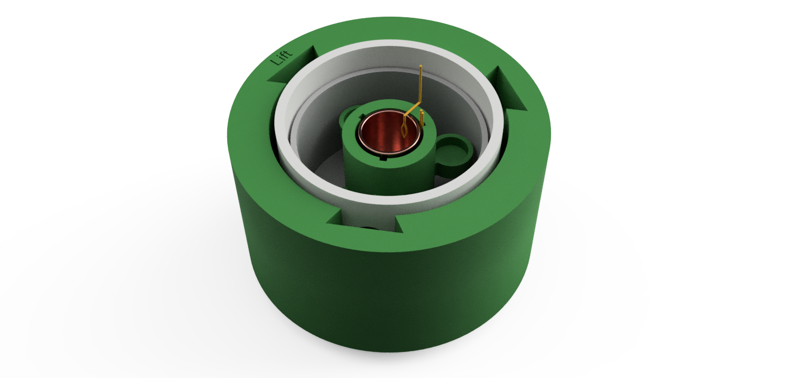

# 05 Temperature-controlled cup
The temperature-controlled cup module is one of the added functionality modules. The module, along with its supporting electronics, is able to measure and control the temperature of the ethane. In doing so, the temperature of the ethane can be actively controlled and stabilized. The idea is that by monitoring the temperature of the ethane, consistency can be obtained over multiple plunges. This cup assembly acts as a direct replacement for the traditional Styrofoam cup assembly used in vitrification. If one does not want to use this module, it can always be interchanged with the traditional Styrofoam assembly.

Below, a picture of the assembly is shown. Right below that, an exploded view with the corresponding parts list is displayed. 

The thermocouple and heater element are just very rough placeholder CAD files in the assembly. They are mainly included to give an idea of where they should be placed. The heater is placed below the brass cup, directly heating the brass cup. The thermocouple hangs into the brass cup in direct contact with the ethane. Due to the cups within this assembly being 3d printed, no spider is required to conduct the cooling of the nitrogen towards the brass cup. The 3d print conducts sufficiently for that already.

The base cup is also made hollow for this reason. If the nitrogen heats up too quickly, one can then fill the hollow structure of the base cup with foam so that the insulation value of the base cup increases.

## Assembly instructions: Temperature-controlled cup Assembly
For the Temperature-Controlled cup assembly, a short assembly animation video is shown below.

https://github.com/user-attachments/assets/f9492a5c-6df6-429e-abe3-7f9b945a3209

